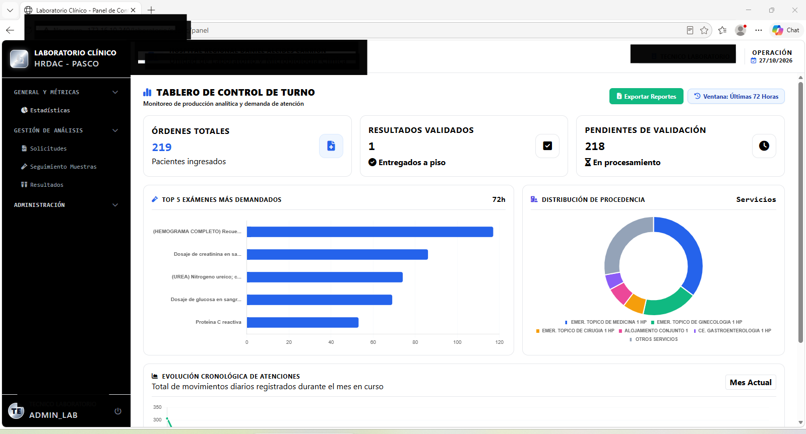
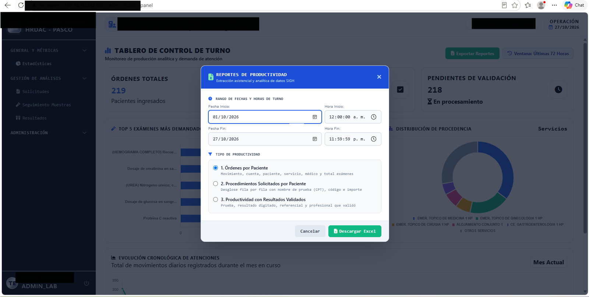
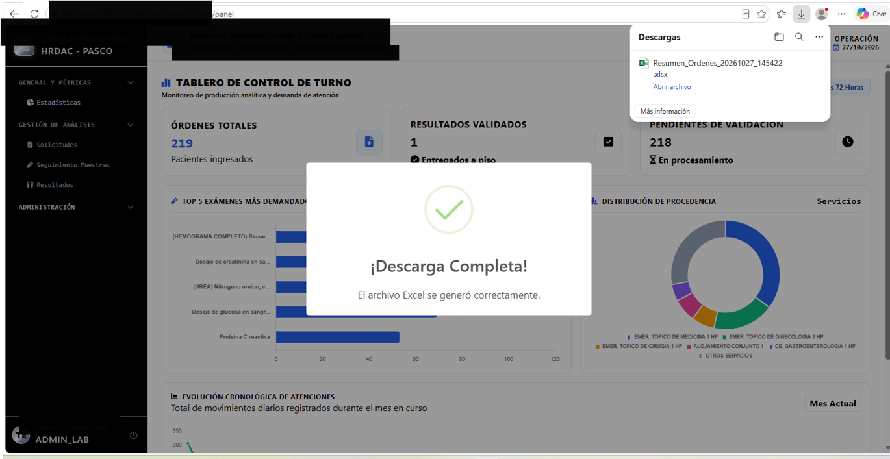

# 🏥 LIS Hospitalario - Core de Laboratorio Clínico & Interoperabilidad SIGH

Sistema de Información de Laboratorio (LIS) de alto rendimiento, diseñado para operar sobre infraestructura hospitalaria pública y coexistir con sistemas legados del Ministerio de Salud (**SIGH / SIS-GalenPlus**).

---

## 👨‍💻 Autoría y Propiedad Intelectual

* **Autor:** Ing. Anhgelo Smith Vega Poma
* **Especialidad:** Ingeniería de Sistemas y Computación
* **Colegiatura:** Colegio de Ingenieros del Perú — **CIP N° 381913** (Sede Pasco)
* **Licencia:** *Proprietary / View-Only License* (Exclusivo para evaluación técnica y portafolio).

---

## 🏛️ Arquitectura del Sistema e Interoperabilidad

El proyecto implementa un patrón desacoplado y multi-motor para resolver cuellos de botella operativos en centros hospitalarios de alta demanda:

┌────────────────────────────────────────────────────────┐
│             UI / Frontend (SPA Reactiva)               │
│   Tailwind CSS + Vanilla JS AJAX + SweetAlert2 Modals  │
└───────────────────────────▲────────────────────────────┘
│ HTTP / JSON / Streams
┌───────────────────────────▼────────────────────────────┐
│          Backend Micro-Framework (PHP Slim 4)          │
│       Inyección de Dependencias (PHP-DI) + PSR-7       │
└─────────────┬────────────────────────────┬─────────────┘
│                            │
▼ (sqlsrv / ODBC 18)         ▼ (pg_connect / PDO)
┌──────────────────────────┐  ┌──────────────────────────┐
│   SQL Server (Clínico)   │  │   PostgreSQL (Local)     │
│   Base de Datos SIGH     │  │   Control de Acceso ACL  │
│   - Catálogo Tarifario   │  │   - Sesiones y Roles     │
│   - Atenciones / Órdenes │  │   - Usuarios Validados   │
│   - Analitos y Muestras  │  │   - Insumos y Logística  │
└──────────────────────────┘  └──────────────────────────┘

### 1. Desacoplamiento de Seguridad y Rendimiento (Dual-Engine)
* **PostgreSQL (Capa ACL y Transacciones Locales):** Gestiona la autenticación, roles granulares (`admin`, `tecnico`, `tecnologo`) y firmas analíticas sin alterar el esquema del ERP institucional.
* **SQL Server (Interoperabilidad SIGH/GalenPlus):** Extracción analítica en tiempo real mediante directivas de concurrencia (`NOLOCK`) e índices no agrupados optimizados para servidores restringidos en memoria RAM (< 3 GB).

### 2. Blindaje de Integridad de Datos Legacy
* Manejo estricto de discrepancias de tipado histórico en bases de datos hospitalarias (prevención de conversiones implícitas de `VARCHAR` a `INT` en campos de atenciones clínicas).
* Formateo determinístico de fechas bajo el estándar canónico ODBC (`Style 120`), asegurando neutralidad frente a configuraciones regionales del servidor.

---

## ⚡ Funcionalidades Principales

* **Tablero de Control de Turno en Tiempo Real:** Monitoreo reactivo de muestras ingresadas, procesadas y pendientes de validación analítica.
* **Módulo de Digitación y Homologación de Resultados:** Integración dinámica de plantillas referenciales y métodos automatizados por analito.
* **Generación Nativa de Reportes Institucionales (`.xlsx`):**
  * Exportación de productividad por órdenes y pacientes.
  * Consolidado oficial de procedimientos CPT con desglose tarifario dinámico cruzado con `FactCatalogoServiciosHosp` según fuente de financiamiento (SIS / Particular).
  * Reporte de analitos validados con trazabilidad de tecnólogos y técnicos responsables.
* **Protección Transaccional de UX:** Control de estados de carga y listeners de interrupción (`beforeunload`) para prevenir la degradación del motor SQL Server durante consultas masivas de rangos mensuales.

---

## 🛠️ Stack Tecnológico

* **Lenguaje:** PHP 8.x
* **Framework:** Slim 4 (Arquitectura REST modular con Middleware ACL)
* **Bases de Datos:** Microsoft SQL Server (Transaccional Clínico) & PostgreSQL (Seguridad y Metadatos)
* **Librerías Core:** `PhpSpreadsheet` (Generación OpenXML binaria directa en memoria), `PHP-DI`
* **Frontend:** JavaScript Vanilla, Tailwind CSS, SweetAlert2
* **Entorno de Despliegue:** Linux Ubuntu Server / Apache 2.4

---

## 🚀 Despliegue Local

1. **Clonar repositorio:**
   ```bash
   git clone [https://github.com/LYONIKKI/laboratorio-clinico-core.git](https://github.com/LYONIKKI/laboratorio-clinico-core.git)
   cd laboratorio-clinico-core

2. **instalar composer:**
composer install
3. **Copiar .env.example como .env y configurar credenciales locales::** 
cp .env.example .env
4. **Migración de esquema PostgreSQL:**
psql -U tu_usuario -d tu_bd -f databasepg/schema.sql

## 📸 Demostración Visual de la Plataforma

### Tablero de Control de Turno y Demanda Analítica


### Módulo de Extracción y Reportabilidad Oficial (.xlsx)
| Selector de Filtros y Rango de Turno | Reporte Oficial Generado (Formato GalenPlus) |
|:---:|:---:|
|  |  |